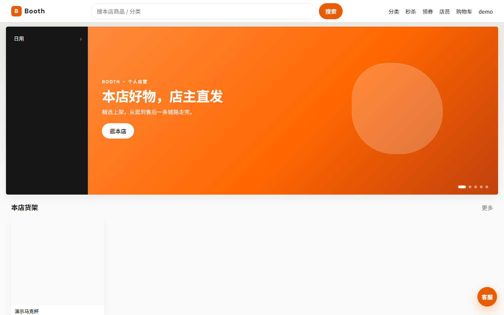
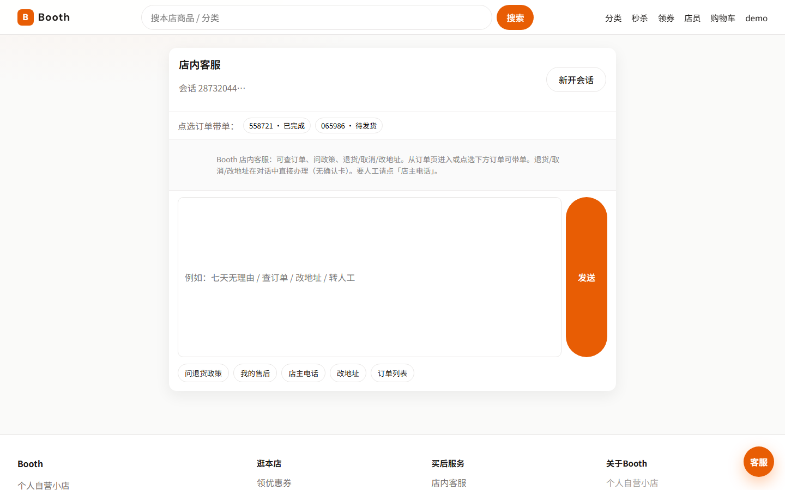
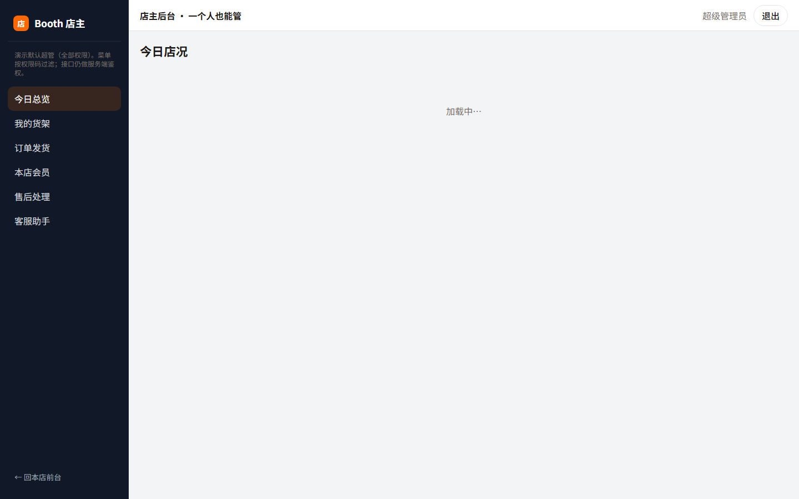

# Booth Suite

个人自营电商演示项目：商城交易链路 + 店主后台 + 智能客服。

适合本地 `clone` 后按文档跑通；默认配置仅用于本机演示，不要直接当生产环境。

<p align="center">
  
  
  
</p>

## Features

- 会员端：浏览、购物车、下单、Mock 支付、售后
- 店主后台：商品 / 订单 / 会员 / 售后
- 智能客服：查单、政策问答、退货 / 取消 / 改地址（校验后直写商城，SSE 推送进度）
- 可选 Elasticsearch 搜索、Prometheus / Grafana 观测

## Structure

```text
booth-suite
├── booth-cloud   # Spring Cloud：网关 / 用户 / 商品 / 交易 / 搜索
├── booth-agent   # 客服 Agent（工具调用 + 知识库）
└── booth-web     # Vue 3 前台 + 管理后台
```

## Requirements

- JDK 17、Maven 3.9+
- Node.js 20+
- Docker Desktop（Compose）

## Quick start

### 1. Backend (`booth-cloud`)

```powershell
cd booth-cloud
powershell -File deploy\gen-env.ps1
mvn -DskipTests package
docker compose -f deploy/docker-compose.yml --env-file deploy/.env up -d --build
```

Gateway: `http://localhost:8080`

可选 profile：

| Profile | 额外组件 |
|---------|----------|
| `search` | Elasticsearch + booth-search |
| `obs` | Prometheus / Grafana / Zipkin |
| `full` | search + obs |

### 2. Web (`booth-web`)

```bash
cd booth-web
npm install
npm run dev
```

- Storefront: `http://localhost:5173/`
- Admin: `http://localhost:5173/admin`

Vite 开发代理：`/gw` → `8080`，`/agent` → `8091`。

### 3. Agent（可选，`booth-agent`）

需先有可用的 `booth-cloud` 网关。

```bash
cd booth-agent
mvn -DskipTests package
docker compose up -d --build
```

Agent: `http://localhost:8091`  
未配置模型密钥时走规则选工具；配置 OpenAI 兼容密钥后可由模型选工具。

## Demo accounts

| Role | Username | Password |
|------|----------|----------|
| Admin | `admin` | `admin123` |
| Member | 自行注册 | — |

商品种子会写入「演示马克杯」。订单需自行下单产生。  
支付为 **Mock + 接口预留**，未配置沙箱密钥时不要宣称已对接真支付宝。

## Security

默认口令、中间件端口仅限本机。公开前请改密，并避免把数据库 / Redis / Nacos 等端口暴露到公网。详见 [SECURITY.md](SECURITY.md)。

## License

[MIT](LICENSE)
