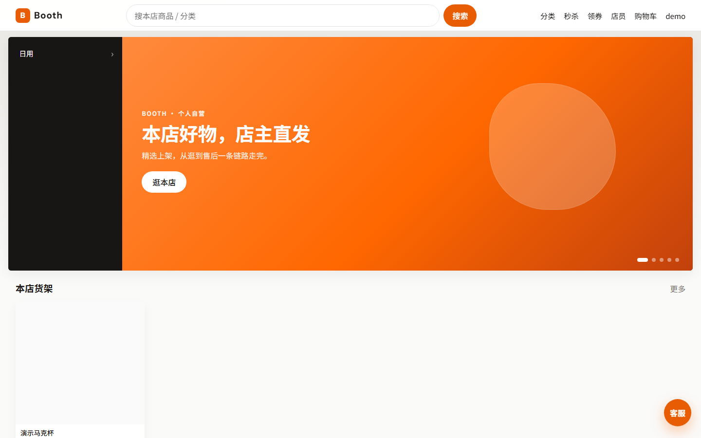
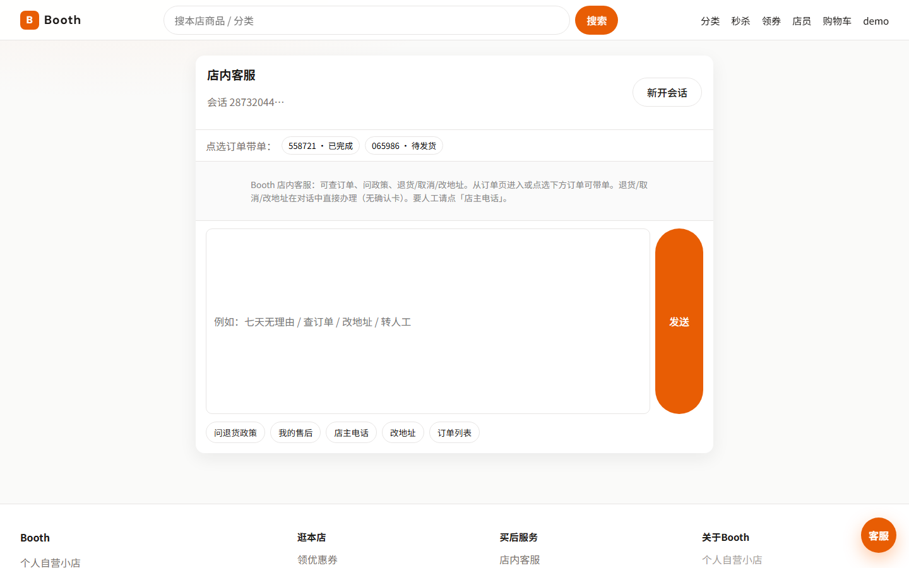
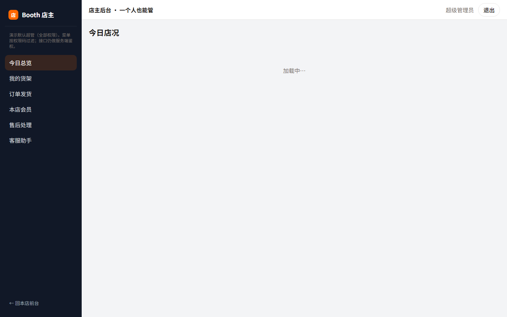

# Booth Suite

自营电商全链路系统，基于 Spring Cloud 与 Vue 3 构建，集成智能客服 Agent，覆盖商城交易、店主后台与客服能力。

本地 Docker Compose 即可联调；默认配置仅用于本机演示。

<p align="center">
  
  
  
</p>

## 功能特性

- **商品浏览与下单**：会员端支持首页、分类、搜索、详情、购物车、结算、订单与个人中心
- **店主经营后台**：商品 / 订单 / 会员 / 售后管理，并提供客服运营摘要
- **微服务交易底座**：网关 + 用户 / 商品 / 交易拆分，支持会员与管理员登录及基础 RBAC
- **支付与售后闭环**：Mock 支付（预留扩展接口），售后流程由交易服务承接
- **AI 智能回复**：多轮工具调用 + 会话上下文；无密钥时规则选工具，配置 OpenAI 兼容密钥后可由模型选工具
- **政策知识检索**：基于 pgvector 检索售后 / 物流等政策，回答可带回 sources
- **对话内办单**：退货、取消待付款、改地址经身份与归属校验后直写商城；参数指纹 + outbox 幂等，带写熔断
- **流式对话体验**：Web 主路径走 SSE，先推进度事件再推正文
- **智能转人工**：需要人工时给出店主联系方式完成转接
- **可插拔扩展**：可选 Elasticsearch 商品搜索，以及 Prometheus / Grafana / Zipkin 观测

## 环境要求

- Java >= 17、Maven 3.9+
- Node.js >= 20
- Docker Desktop（Compose）

## 启动

### 1. booth-cloud

```powershell
cd booth-cloud
powershell -File deploy\gen-env.ps1
mvn -DskipTests package
docker compose -f deploy/docker-compose.yml --env-file deploy/.env up -d --build
```

### 2. booth-web

```bash
cd booth-web
npm install
npm run dev
```

### 3. booth-agent（可选）

```bash
cd booth-agent
cp .env.example .env
mvn -DskipTests package
docker compose up -d --build
```

## 项目结构

```text
booth-cloud/                 # 交易底座（Spring Cloud）
├── booth-gateway/           # API 网关
├── booth-user/              # 会员 / 管理员 / RBAC
├── booth-product/           # 商品与库存
├── booth-trade/             # 订单 / Mock 支付 / 售后
├── booth-search/            # Elasticsearch 搜索（可选）
├── booth-common/            # 公共组件
├── booth-api/               # API 契约
└── deploy/                  # 部署与观测配置

booth-agent/                 # 智能客服
└── .../agent/
    ├── chat/                # 对话入口（含 SSE）
    ├── intent/              # 意图路由
    ├── llm/                 # 模型与工具循环
    ├── tool/                # 工具注册与执行
    ├── knowledge/           # 政策知识库 / 向量检索
    ├── write/               # 直写、幂等与写熔断
    ├── session/             # 会话上下文
    └── store/               # 调用商城网关

booth-web/                   # 会员端 + 店主后台（Vue 3）
└── src/
    ├── api/                 # 接口封装
    ├── views/               # 页面
    ├── components/          # 组件
    ├── stores/              # 状态
    └── router/              # 路由
```

## 技术栈

| 类别 | 技术 |
|------|------|
| 前端 | Vue 3、TypeScript、Vite、Pinia、Vue Router、Axios |
| 后端框架 | Spring Boot 3、Spring Cloud、Spring Cloud Alibaba（Nacos） |
| 认证与数据访问 | Sa-Token、MyBatis-Plus、Flyway |
| 中间件 | MySQL、Redis、RabbitMQ |
| 智能客服 | Spring AI（OpenAI 兼容）、PostgreSQL + pgvector、SSE |
| 可选组件 | Elasticsearch、Prometheus、Grafana、Zipkin |
| 构建与交付 | Maven、npm、Docker Compose |

## License

[MIT](LICENSE)
